# Contents

* Note S1. Model implementation and assumptions
* Note S2. Governing equations
* Note S3. Reproduction results (Tables S0–S12, Figs S1–S12)
* Note S4. Hardware digital twin: emulated bench characterisation (Tables E1–E5, Figs E1–E5)
* Note S5. Code and data availability

> **Status of results.** Every number in this document comes from a
> simulation. Notes S1–S3 are deterministic model results. Note S4 is a
> Monte Carlo emulation of expected hardware measurements. No device has
> been fabricated and no measurement has been made. All Note S4 items are
> labelled *EMULATED*.

# Note S1. Model implementation and assumptions

The models were implemented independently in Python (NumPy/SciPy) in the
open-source package `cmutsim`. One script, `run_all.py`, regenerates every
table and figure, with a fixed random seed (20261019). A full
run takes about 184 s on a single CPU core.

**Table S-A. Parameters used in addition to manuscript Tables I–II.**

| Quantity | Value | Basis |
|---|---|---|
| Plate material | Si₃N₄, E = 250 GPa, ν = 0.23, ρ = 3100 kg/m³ | Literature values for LPCVD nitride |
| Insulation layer | 0.15 µm SiO₂ (ε_r = 3.9) | Typical CMUT process |
| Element elevation height | 6 mm (unfocused) | Assumed |
| Cell pitch / cells per element | 66 µm / 540 | Assumed |
| Element clamped capacitance | 67.6 pF | Derived |
| Effective coupling k² (BVD) | 0.5 | Assumed (biased near 0.8 V_c) |
| Homogeneous attenuation | 0.54 dB/cm/MHz | Soft tissue |
| Field discretisation | 4 strips per element; Fresnel elevation integral | — |
| Field grid | 0.1 mm (maps); 5 µm lateral, 20 µm axial (profiles) | Convergence-checked |
| Thermal/elastic grid | 0.3 mm, 3-D, 48 × 48 × 64 mm domain | — |
| Thermal properties | IT'IS v4.1 (tumour; fat as worst case) | Ref. [18] of the manuscript |

# Note S2. Governing equations

**CMUT cell.** Clamped-plate rigidity D = Et³/12(1−ν²) and piston-equivalent
stiffness k = 64πD/a². The collapse voltage is

$$V_c=\sqrt{\frac{8k\,g_\mathrm{eff}^3}{27\varepsilon_0\pi a^2}},\qquad g_\mathrm{eff}=g_0+t_i/\varepsilon_r .$$

The vacuum resonance is f = 10.21/(2πa²)·√(D/ρt). Fluid loading enters
through the added-mass factor β = 0.6689(ρ_f/ρ_p)(a/t), and the bias
softens the spring as k − ε₀AV²/(g−x)³.

**Acoustic field.** The Rayleigh–Sommerfeld integral is discretised over
element strips, and the elevation integral is evaluated in closed form
(Fresnel):

$$p(\mathbf r)=\sum_n w_n e^{-j\omega\tau_n}\frac{jk}{2\pi}\,\frac{1+\cos\theta_n}{2}\,\frac{e^{-jkR_n-\alpha R_n}}{R_n}\int_{-H/2}^{H/2}e^{-jky^2/2R_n}dy .$$

In the layered model, phase, attenuation and normal-incidence transmission
coefficients accumulate along straight rays through each layer.

**Safety indices.** I = |p|²/2ρc and MI = p_r[MPa]/√f[MHz]. TIS = W·f/210
mW·MHz and TIB = √(W·I_ta)/50, following IEC 62359.

**Bioheat.** The Pennes equation is solved exactly in k-space:

$$\hat T(\mathbf k,t)=\frac{\hat q(\mathbf k)}{\rho c\,\lambda(\mathbf k)}\left(1-e^{-\lambda t}\right),\quad \lambda=\frac{\kappa}{\rho c}|\mathbf k|^2+\frac{w_b\rho_b c_b}{\rho c},\quad q=2\alpha I_{ta}.$$

**Radiation force.** The body force is F = 2αI_ta/c. The static
displacement uses the incompressible Kelvin solution
u_z = F/(8πμr)(1 + Δz²/r²), convolved by FFT.

**Control.** The plant is first-order-plus-dead-time,
G(s) = K e^(−θs)/(τs + 1), with K = 1, τ = 60 ms and θ = 5 ms (zero-order
hold of a 100 Hz estimate). The controller is a discrete PI (K_p = 4,
K_i = 55 s⁻¹) with conditional-integration anti-windup, and the plant
output is clipped at 0.

**Sample size.** A two-sided two-sample t-test, using the non-central t
distribution, at α = 0.05 (Bonferroni-corrected for 4 doses) and power 0.8.

# Note S3. Reproduction results

**Table S0. Manuscript values vs independent reproduction vs emulated hardware.**

| Metric | Manuscript | Reproduced (model) | Emulated hardware | Note |
|---|---|---|---|---|
| Collapse voltage (V) | 46.5 | 51.6 | 51.6 +/- 3.2 | Within 11 %; depends on E and insulator (assumed) |
| Immersed cell resonance (MHz) | 1.5 (implied) | 2.60 | - | MISMATCH: a ~ 37.7 um needed for 1.5 MHz |
| -6 dB fractional BW (%) | 51.8 | 47.8 | - | Consistent with Q = 3.5 |
| Lateral FWHM (mm) | 0.69 | 0.94 (-6 dB) / 0.69 (-3 dB) | 0.938 +/- 0.023 | Manuscript value equals the -3 dB (intensity) width |
| Axial FWHM (mm) | 3.74 | 5.50 (-6 dB) / 3.95 (-3 dB) | 5.476 +/- 0.020 | Manuscript value close to -3 dB width |
| Peak focal pressure (kPa) | 12.0 | 12.0 (set) | 12.365 +/- 0.842 | Hardware spread from cal. uncertainty + element errors |
| Steering loss at +/-20 deg (dB) | -0.33 | -0.28 | - | - |
| Isppa (mW/cm^2) | 4.45 | 4.45 | - | rho\*c = 1050\*1540 |
| MI | 0.010 | 0.0098 | - | Agrees |
| Peak dT, 20 % duty (mK) | 0.37-0.4 | 0.419 | below thermocouple LOD | Same order; 3-D model |
| Thermal index | 0.0004 (= dT) | TIS 6.58e-04 | - | Manuscript TI equals dT numerically; use IEC 62359 TIS/TIB |
| Settling time (ms) | 150 | 170 | - | Plant fitted (FOPDT) |
| Disturbance recovery (ms) | 426 | 181 | - | Depends on disturbance definition (n.r. in manuscript) |
| Peak with HW errors, flat (kPa) | - | 12.0 | 11.803 +/- 0.224 | Expect ~0.5-1 dB loss on hardware |
| Pressure at target, curved R=60 mm uncorrected (kPa) | - | 12.0 | 3.344 +/- 0.177 | Focus moves toward skin; shape sensing required |
| Pressure at target, curved R=60 mm corrected (kPa) | - | 12.0 | 11.365 +/- 0.230 | Restored by correction |

**Table S1. CMUT cell and element.**

| Quantity | Manuscript | Reproduced |
|---|---|---|
| Collapse voltage Vc (V) | 46.5 | 51.59 |
| Clamped capacitance per cell C0 (pF) | 0.125 | 0.125 |
| Vacuum resonance (MHz) | n.r. | 7.214 |
| Immersed resonance, 0 V (MHz) | n.r. | 3.067 |
| Immersed resonance, 0.8 Vc (MHz) | 1.5 (implied) | 2.6 |
| Radius for 1.5 MHz immersed at 0.8 Vc (um) | 30.0 | 37.67 |
| Cells per element (assumed 6 mm elevation) | n.r. | 540 |
| Element C0 (pF) | n.r. | 67.59 |
| -6 dB fractional bandwidth (%) | 51.8 | 47.85 |
| -3 dB fractional bandwidth (%) | n.r. | 28.12 |
| Surface pressure per volt at 0.8 Vc (Pa/V) | n.r. | 5428 |

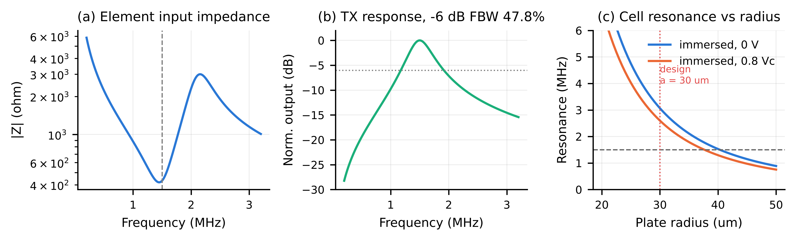{width=100%}

**Table S2. Focused field at 20 mm (homogeneous medium, rectangular apodization).**

| Quantity | Manuscript | Reproduced |
|---|---|---|
| Focal depth of peak (mm) | 20.0 | 19.78 |
| Peak focal pressure (kPa) | 12.0 | 12 |
| Lateral FWHM, pressure -6 dB (mm) | 0.69 | 0.941 |
| Lateral FWHM, intensity -3 dB (mm) | - | 0.693 |
| Axial FWHM, pressure -6 dB (mm) | 3.74 | 5.503 |
| Axial FWHM, intensity -3 dB (mm) | - | 3.954 |
| Isppa (mW/cm^2) | 4.45 | 4.453 |
| Ispta at 20 % duty (mW/cm^2) | 0.891 | 0.891 |
| Required surface pressure (kPa) | n.r. | 2.792 |
| Required AC drive at 0.8 Vc bias (V) | n.r. | 0.514 |
| Acoustic output power, CW (mW) | n.r. | 0.416 |

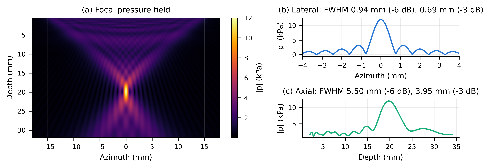{width=100%}

**Table S3. Beam steering at a 20 mm focal range.**

| Steer (deg) | Peak (kPa) | Peak change (dB) | Lateral FWHM along x (mm) | FWHM perp. to beam -6 dB (mm) | FWHM perp. to beam -3 dB (mm) | Focal position error (mm) |
|---|---|---|---|---|---|---|
| -20 | 11.61 | -0.284 | 0.978 | 0.96 | 0.706 | 0.08 |
| -10 | 11.9 | -0.0722 | 0.95 | 0.946 | 0.696 | 0.18 |
| 0 | 12 | 0 | 0.941 | 0.941 | 0.693 | 0.22 |
| 10 | 11.9 | -0.0722 | 0.95 | 0.946 | 0.696 | 0.18 |
| 20 | 11.61 | -0.284 | 0.978 | 0.96 | 0.706 | 0.08 |

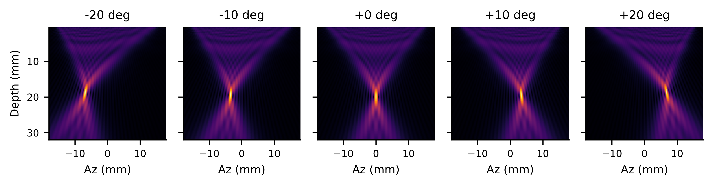{width=100%}

**Table S4. Grating lobes against pitch, 20° steer, evaluated on the 20 mm arc.**

| Pitch (lambda) | Pitch (mm) | Predicted GL angle (deg) | Grating-lobe level (dB) | Peak lobe outside main lobe (dB) |
|---|---|---|---|---|
| 0.5 | 0.513 | - | - | -15.99 |
| 0.75 | 0.77 | -82.44 | -13 | -12.22 |
| 1 | 1.027 | -41.15 | -12.05 | -12.05 |
| 1.5 | 1.54 | -18.94 | -5.011 | -5.011 |

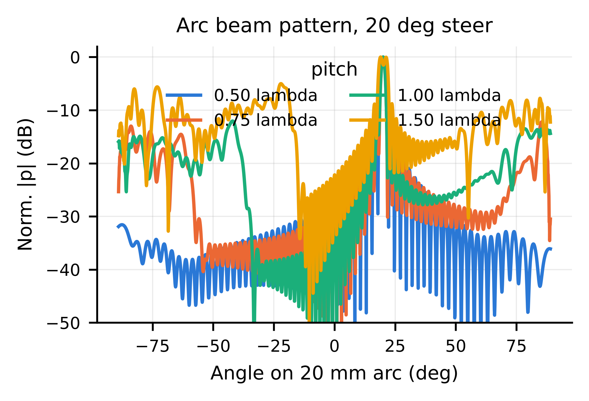{width=100%}

**Table S5. Apodization trade-off.**

| Window | Main lobe -6 dB (mm) | Main lobe -3 dB (mm) | Peak side lobe (dB) | Focal gain vs rect (dB) |
|---|---|---|---|---|
| Rect | 0.941 | 0.693 | -11.49 | 0 |
| Hann | 1.401 | 1.015 | -21.99 | -5.2 |
| Hamming | 1.334 | 0.966 | -23.76 | -4.862 |
| Tukey | 1.161 | 0.851 | -13.04 | -2.173 |

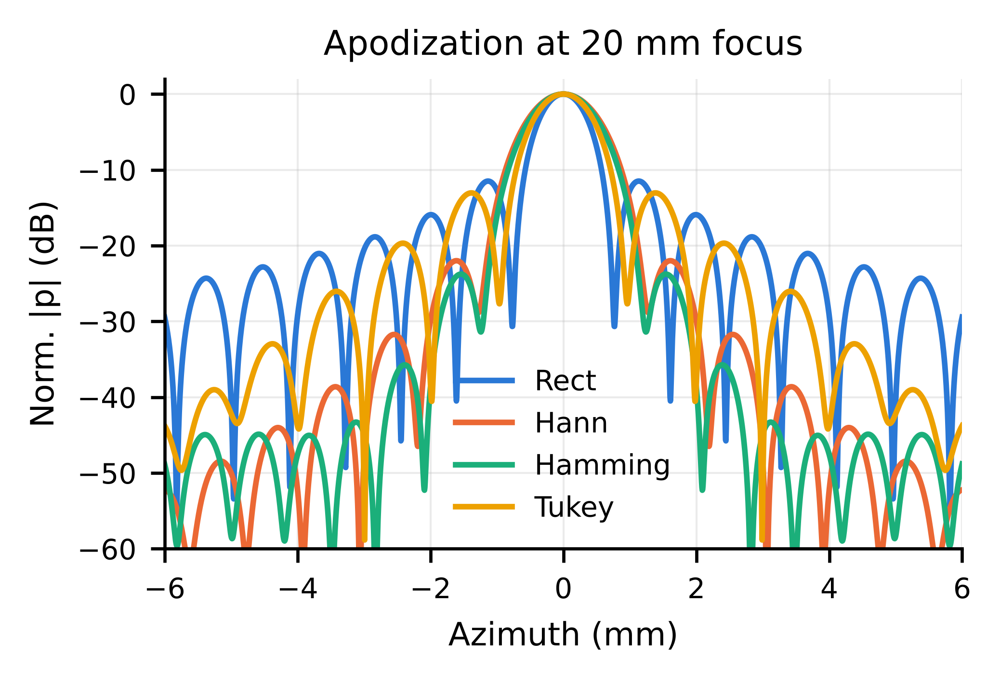{width=100%}

**Table S6. Effect of the skin–fat–muscle–tumour stack.**

| Delay law | Peak depth (mm) | Lateral FWHM (mm) | Axial FWHM (mm) | Drive increase vs homogeneous (dB) |
|---|---|---|---|---|
| homogeneous-delay | 19.98 | 0.941 | 5.4 | 0.474 |
| layer-corrected | 19.78 | 0.933 | 5.308 | 0.436 |

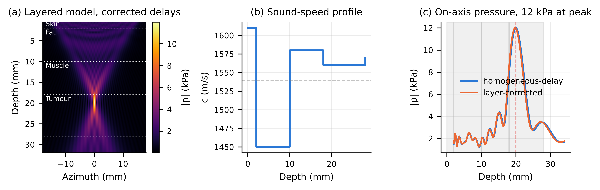{width=100%}

**Table S7. Pennes bioheat (3-D) and IEC thermal indices.**

| Thermal props | Duty (%) | Steady dT (mK) | dT at 4 min (mK) | Hot-spot depth (mm) | Ispta (mW/cm^2) | TIS | TIB |
|---|---|---|---|---|---|---|---|
| Tumour | 5 | 0.105 | 0.0869 | 20.1 | 0.223 | 0.000164 | 0.00143 |
| Tumour | 20 | 0.419 | 0.348 | 20.1 | 0.891 | 0.000658 | 0.00573 |
| Tumour | 50 | 1.048 | 0.869 | 20.1 | 2.226 | 0.00164 | 0.0143 |
| Tumour | 100 | 2.096 | 1.738 | 20.1 | 4.453 | 0.00329 | 0.0286 |
| Fat | 5 | 0.246 | 0.198 | 20.1 | 0.223 | 0.000164 | 0.00143 |
| Fat | 20 | 0.985 | 0.792 | 20.1 | 0.891 | 0.000658 | 0.00573 |
| Fat | 50 | 2.464 | 1.979 | 20.1 | 2.226 | 0.00164 | 0.0143 |
| Fat | 100 | 4.927 | 3.959 | 20.1 | 4.453 | 0.00329 | 0.0286 |

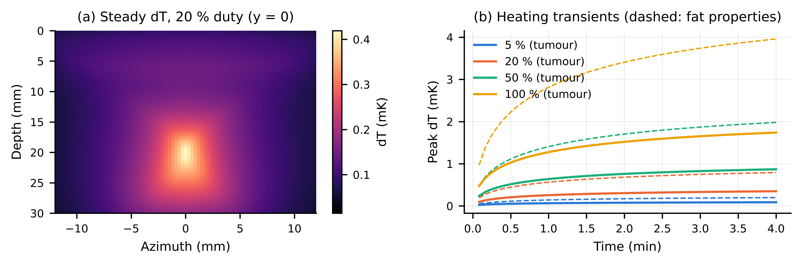{width=100%}

**Table S8. Mechanical index and cavitation margin.**

| p (kPa) | MI | Isppa (mW/cm^2) | Margin to FDA MI 1.9 (x) | Margin to MI 0.7 nucleation (x) |
|---|---|---|---|---|
| 10 | 0.00816 | 3.092 | 232.7 | 85.73 |
| 12 | 0.0098 | 4.453 | 193.9 | 71.44 |
| 15 | 0.0122 | 6.957 | 155.1 | 57.15 |
| 30 | 0.0245 | 27.83 | 77.57 | 28.58 |
| 50 | 0.0408 | 77.3 | 46.54 | 17.15 |

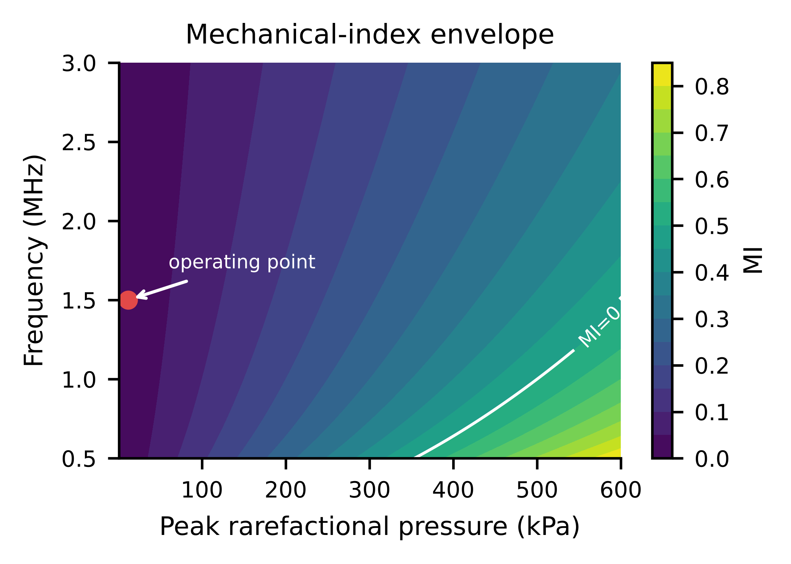{width=100%}

**Table S9. Acoustic radiation force and static displacement (20 % duty).**

| Layer | Peak Isppa on axis (W/m^2) | Ispta at 20 % (W/m^2) | Peak body force (N/m^3) | Peak static displacement (nm) | Peak axial strain (-) |
|---|---|---|---|---|---|
| Skin | 1.841 | 0.368 | 0.00474 | 0.00248 | 1.23e-10 |
| Fat | 1.902 | 0.38 | 0.00435 | 0.041 | 1.5e-09 |
| Muscle | 16.41 | 3.282 | 0.0409 | 0.011 | 9.74e-10 |
| Tumour | 44.52 | 8.904 | 0.138 | 0.005 | 3.84e-10 |

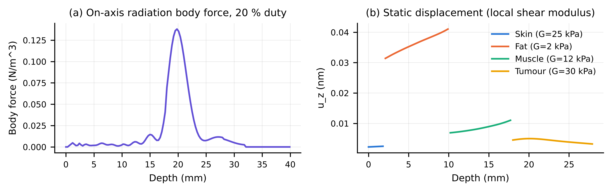{width=100%}

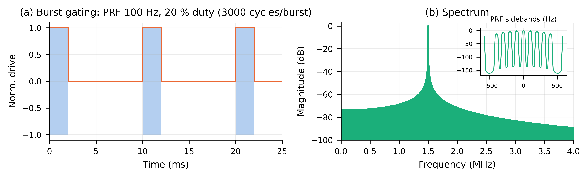{width=100%}

**Table S10. Closed-loop regulation.**

| Metric | Manuscript | Reproduced |
|---|---|---|
| Kp / Ki / Kd | 4 / 55 / 0 | 4 / 55 / 0 |
| Plant (K, tau, dead time) | FOPDT (n.r.) | 1, 60 ms, 5 ms |
| Settling time, 2 % (ms) | 150 | 170.0 |
| Overshoot (%) | 0.0 | 0.0 |
| Steady-state error (Pa) | 0.03 | 0.038 |
| Recovery after 40 % coupling loss (ms) | 426 | 181.0 |
| Pressure dip during disturbance (kPa) | n.r. | 1.2 |
| Settling, 5 % band, with 0.3 kPa sensor noise (ms) | n.r. | 118.0 |
| MC +/-50 % plant: settling median [95th pct] (ms) | n.r. | 173 [244] |
| MC +/-50 % plant: overshoot max (%) | n.r. | 55.89 |

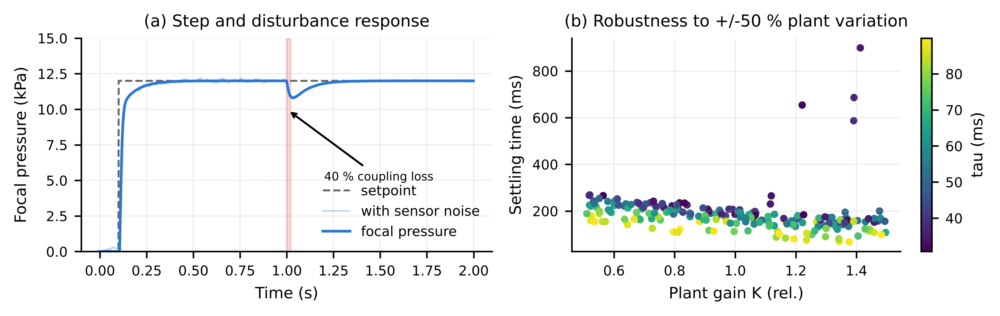{width=100%}

**Table S11. Phase III spheroid sample size.**

| Effect (% reduction) | CV of spheroid assay (%) | n/group (2 groups) | n/group (4 doses vs sham, Bonferroni) |
|---|---|---|---|
| 10 | 10 | 17 | 24 |
| 10 | 15 | 37 | 52 |
| 10 | 20 | 64 | 91 |
| 15 | 10 | 9 | 12 |
| 15 | 15 | 17 | 24 |
| 15 | 20 | 29 | 42 |
| 20 | 10 | 6 | 8 |
| 20 | 15 | 10 | 15 |
| 20 | 20 | 17 | 24 |
| 30 | 10 | 4 | 5 |
| 30 | 15 | 6 | 8 |
| 30 | 20 | 9 | 12 |

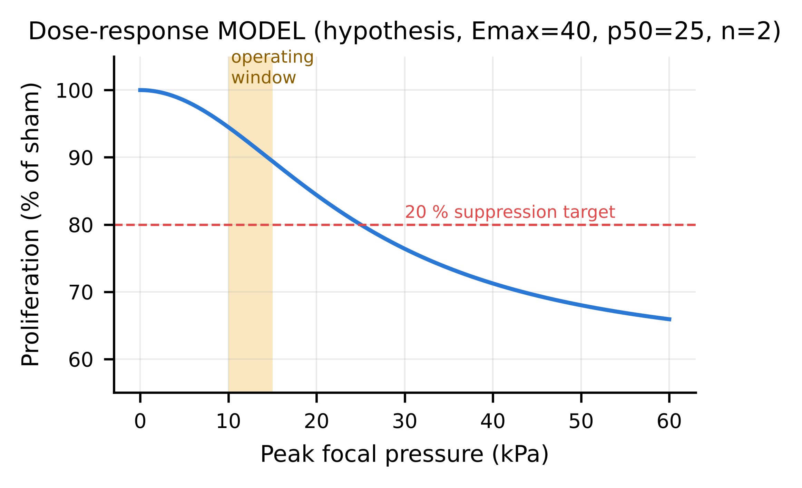{width=100%}

**Table S12. Estimated wearable power budget.**

| Block | Power (mW) | Basis |
|---|---|---|
| Low-power FPGA (beamformer, sequencer, PI) | 150 | vendor class |
| 64-ch low-voltage TX drivers (linear, quiescent) | 192 | 3 mW/ch assumed |
| TX dynamic C\*V^2\*f\*duty (computed) | 0.343 | Vac=0.51 V, C0=68 pF |
| DC bias generator (~41 V, leakage-limited) | 40 | boost + LDO |
| Feedback RX/ADC (8 channels, duty-cycled) | 50 | assumed |
| MCU + BLE link | 15 | assumed |
| TOTAL | 447.3 | - |
| Energy for 4 h session (Wh) | 1.789 | - |
| Battery @3.7 V, 80 % usable (mAh) | 604.5 | - |

# Note S4. Hardware digital twin (EMULATED results)

> The tables and figures in this Note are **emulated**. They are Monte
> Carlo predictions of what a bench characterisation would be expected to
> report, given the error budget in Supplementary file S3. They are **not
> experimental measurements**. They set the acceptance bands for the
> Phase II protocol (Supplementary file S4).

**Table E1. Fabrication Monte Carlo (EMULATED).**

| Quantity | Emulated value |
|---|---|
| Arrays simulated (64 elements each) | 300 |
| Collapse voltage mean +/- SD (V) | 51.6 +/- 3.2 |
| Collapse voltage 1st-99th percentile (V) | 44.5 - 59.2 |
| Element sensitivity spread SD (dB) | 0.63 |
| Element phase spread SD (deg) | 1.55 |
| Array yield at fixed 41 V bias (no trim) (%) | 100.0 |
| Bias for 99 % array yield (V) | 41.4 |

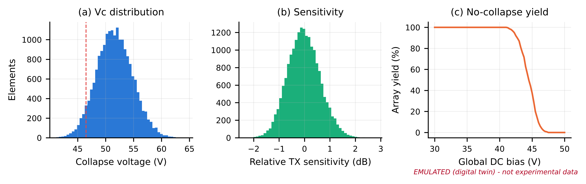{width=100%}

**Table E2. Beam quality under hardware non-idealities (EMULATED).**

| Condition | Peak (kPa) | Pressure at 20 mm target (kPa) | Lateral FWHM (mm) | Axial FWHM (mm) | Axial focus shift (mm) | Lateral focus shift (mm) | Peak side lobe (dB) |
|---|---|---|---|---|---|---|---|
| Ideal (model) | 12.000 | 11.949 | 0.941 | 5.503 | -0.220 | 0.000 | -11.487 |
| Flat patch + HW errors | 11.803 +/- 0.224 | 11.753 +/- 0.223 | 0.941 +/- 0.009 | 5.501 +/- 0.068 | -0.225 +/- 0.018 | 0.000 +/- 0.000 | -11.351 +/- 0.458 |
| Curved R=60 mm, uncorrected | 12.040 +/- 0.209 | 3.344 +/- 0.177 | 0.736 +/- 0.007 | 3.178 +/- 0.043 | -5.293 +/- 0.010 | 0.000 +/- 0.000 | -10.720 +/- 0.390 |
| Curved R=60 mm, shape-corrected | 11.402 +/- 0.228 | 11.365 +/- 0.230 | 0.902 +/- 0.009 | 4.874 +/- 0.075 | -0.156 +/- 0.076 | 0.000 +/- 0.000 | -11.593 +/- 0.671 |

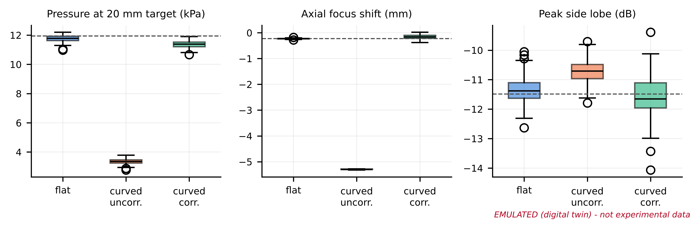{width=100%}

**Table E3. Emulated needle-hydrophone characterisation, n = 5 scans (EMULATED).**

| Quantity | Model (ideal) | Emulated mean +/- SD (n=5) | 95 % CI | Deviation (%) |
|---|---|---|---|---|
| Peak (kPa) | 12 | 12.365 +/- 0.842 | [11.320, 13.411] | 3 |
| Lateral FWHM (mm) | 0.941 | 0.938 +/- 0.023 | [0.909, 0.966] | -0.4 |
| Axial FWHM (mm) | 5.503 | 5.476 +/- 0.020 | [5.451, 5.500] | -0.5 |
| Focus depth (mm) | 19.78 | 19.550 +/- 0.209 | [19.290, 19.810] | -1.2 |

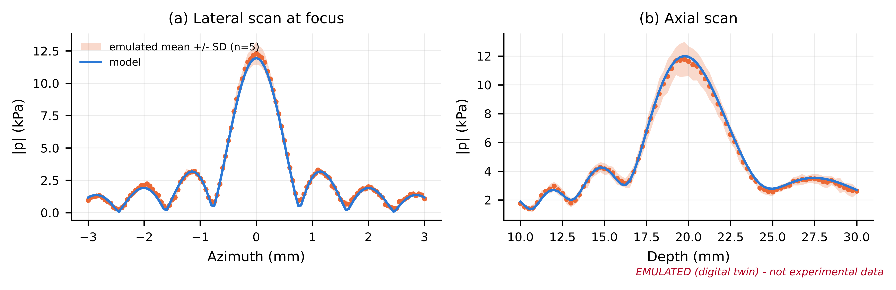{width=100%}

**Table E4. Emulated phantom thermometry (EMULATED).**

| Focal p (kPa) | True dT 100 % duty (mK) | Viscous artefact (mK) | Emulated reading mean (mK) | SD (mK) | LOD 3sigma (mK) | Resolvable? |
|---|---|---|---|---|---|---|
| 12 | 2.096 | 0.629 | 6.58 | 11.25 | 9.487 | no |
| 50 | 36.39 | 10.92 | 48.96 | 9.523 | 9.487 | yes |
| 100 | 145.6 | 43.67 | 189.3 | 13.71 | 9.487 | yes |
| 200 | 582.3 | 174.7 | 760.1 | 10.07 | 9.487 | yes |
| 400 | 2329 | 698.8 | 3029 | 12.57 | 9.487 | yes |

**Table E5. Emulated 4 h closed-loop session (EMULATED).**

| Quantity | Emulated value |
|---|---|
| Session length (h) | 4 |
| Time within 10-15 kPa window (%) | 99.66 |
| Time within +/-5 % of 12 kPa (%) | 90.46 |
| Mean focal pressure (kPa) | 12.03 |
| SD focal pressure (kPa) | 0.485 |
| Drive increase end vs start (dB) | 4.046 |

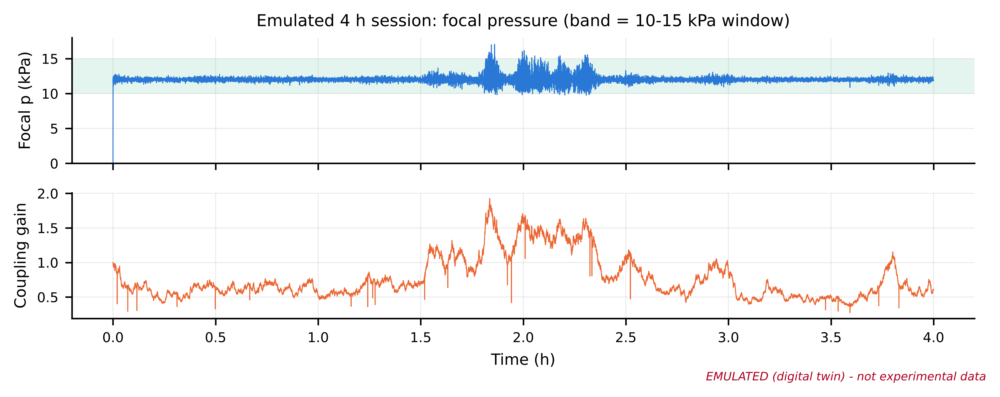{width=100%}

# Note S5. Code and data availability

The code (`cmutsim`, `run_all.py`), all raw numerical data (CSV/NPZ) and
the figures are released under the MIT licence. They will be deposited in
a public repository with a DOI before publication (see file S5).
