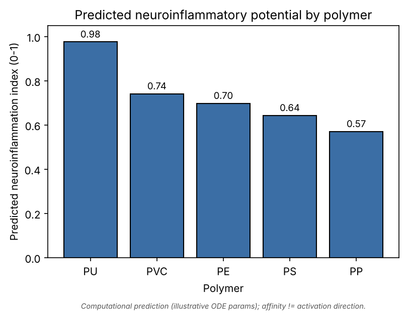
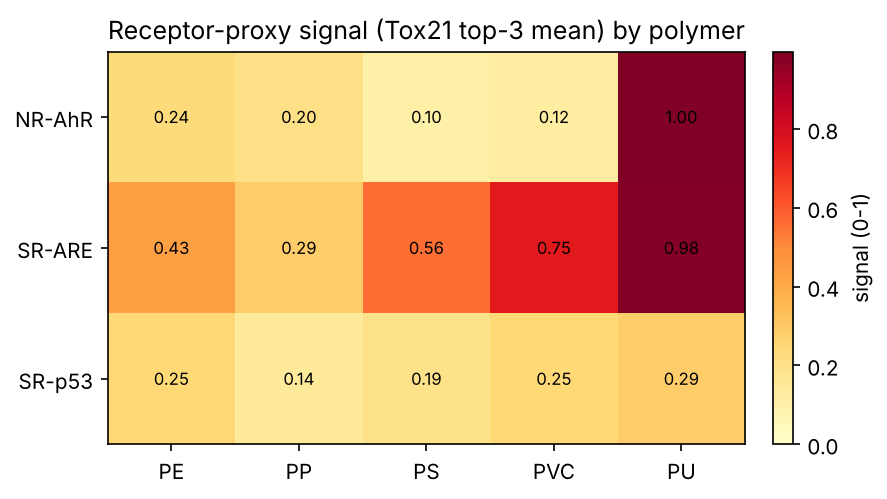
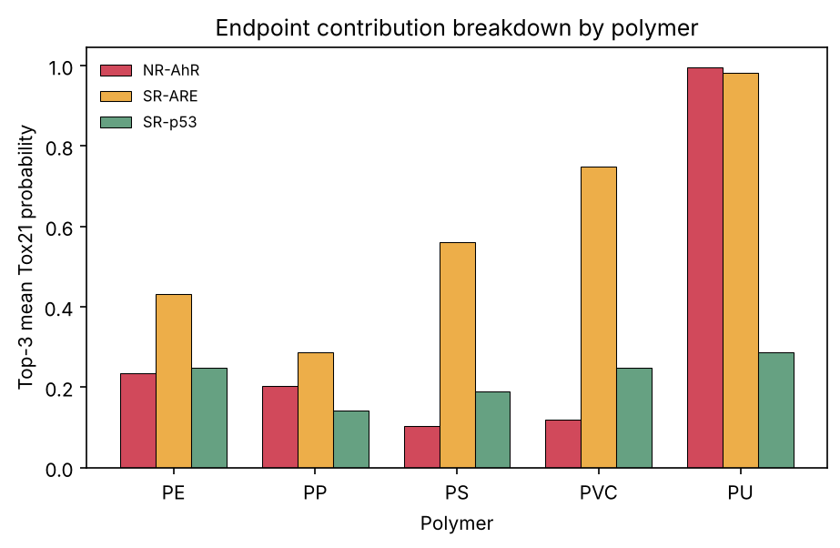

# A Leachate-Centric In-Silico Pipeline for Predicting Polymer-Dependent Neuroinflammatory Potential of Microplastics

*Readable Markdown rendering of the IEEE manuscript
(`microplastics_neuroinflammation_ieee.tex`). The `.tex` file is the formal
IEEE-format submission; this version is for quick reading and review.*

**M. Nisha Angeline** — Professor and Head, Department of Electronics and
Communication Engineering, Velalar College of Engineering and Technology,
Thindal, Erode, Tamil Nadu, India · nishavlsidesign@gmail.com

*Companion computational manuscript to a PRISMA systematic review on
microplastics and neuroinflammation. October 2026.*

---

## Abstract

Whether microplastic *polymer type* governs neuroinflammatory risk is confounded
in the experimental literature by particle size and by the chemical additives and
leachates each polymer carries. We test a falsifiable hypothesis: that predicted
neuroinflammatory potential across polyethylene (PE), polypropylene (PP),
polystyrene (PS), polyvinyl chloride (PVC) and polyurethane (PU) tracks *leachate
chemistry* engaging neuroinflammation receptors rather than the inert polymer
backbone. We assemble a curated, structure-validated inventory of 56 documented
leachates (11–12 per polymer), triage every compound with scaffold-split
RandomForest classifiers trained on three inflammation-relevant Tox21 endpoints
(NR-AhR, SR-ARE, SR-p53), and propagate the aggregated per-polymer signal through
a minimal microglial ODE model (receptor → NF-κB → {TNF-α, IL-6}) to obtain a
normalised neuroinflammation index. The NR-AhR classifier attains a scaffold-split
ROC-AUC of 0.84 and AUPRC of 0.55 (test base rate 0.14). The pipeline predicts
**PU > PVC > PE > PS > PP**, with PU elevated by aromatic-amine hydrolysis products
(toluenediamine, methylenedianiline) and PVC by bisphenol A and phthalates. We
preserve the governing caveat that binding affinity is strength, not activation
direction, and that virtual-cell kinetics are illustrative rather than fitted;
receptor docking into AhR, TLR4–MD2 and NLRP3 is specified and implemented but was
not executed here due to restricted access to structure databases, and no
affinities were fabricated. The ranking is offered as a prioritised, testable
hypothesis for wet-lab confirmation, and the framework directly addresses the
PS-over-study / PE-under-study imbalance in the current evidence base.

**Index Terms —** Microplastics, neuroinflammation, leachates, aryl hydrocarbon
receptor, Tox21, machine learning, molecular docking, systems biology, in-silico
toxicology.

---

## I. Introduction

Microplastics are now detected in human blood, placenta and brain tissue, and
micro- and nanoplastics are reported to cross the blood–brain barrier and provoke
glial activation [1]. A central, unresolved question is whether the *polymer type*
of a particle (PE, PP, PS, PVC, PU) determines the magnitude of the
neuroinflammatory response. The experimental record cannot answer this cleanly:
polymer identity is entangled with particle size, surface chemistry and,
critically, with the distinct sets of additives, residual monomers and adsorbed
contaminants — collectively *leachates* — each polymer carries.

We test the hypothesis that polymer-to-polymer differences are driven largely by
leachate chemistry acting on specific xenobiotic-sensing and innate-immune
receptors — the aryl hydrocarbon receptor (AhR) [2], the TLR4–MD2 complex [3], and
the NLRP3 inflammasome [4] — rather than by the inert backbone. If the computed
ranking matches an experimental ranking from systematic-review screening, the
framework is validated; if not, the discrepancy is itself a falsifiable
prediction.

**Contributions:** (i) a transparent, reproducible five-stage pipeline from
polymer to per-polymer neuroinflammation index; (ii) real scaffold-split ML
performance on inflammation-relevant Tox21 endpoints; (iii) a prioritised polymer
ranking with the dominant leachate and receptor axis per polymer; and (iv) an
explicit, preserved set of caveats so predictions are never mistaken for fact.

## II. Related Work

QSAR models trained on the Tox21 ~10k library are a standard first-pass triage,
with NR-AhR and SR-ARE among the most predictive, interpretable endpoints [5].
Molecular docking with AutoDock Vina [6], [7] is the workhorse for
receptor-engagement screening, and AlphaFold [8] supplements experimental PDB
structures [9] where co-crystals are unavailable. Open inventories such as
PlastChem [10] now catalogue plastic-associated chemicals at a scale usable for
systematic in-silico screening. Our contribution chains these into a single
leachate-to-microglia prediction and foregrounds the affinity-versus-direction
problem that docking-only studies leave implicit.

## III. Materials and Methods

**Stage 1 — Leachate inventory.** Documented additives, residual monomers and
adsorbed contaminants were curated as canonical SMILES, validated and standardised
in RDKit [11]; any string failing to parse was discarded. The inventory holds 56
compounds (PE 12; PP/PS/PVC/PU 11 each), deliberately covering the under-studied
PE and additive-rich PVC/PU as strongly as the frequently studied PS.

**Stage 2 — Tox21 ML triage.** One classifier per endpoint: **NR-AhR** (aryl
hydrocarbon receptor), **SR-ARE** (Nrf2/antioxidant response), **SR-p53**
(genotoxic stress). Molecules were featurised as 2048-bit Morgan fingerprints
(radius 2); 7,823 structures survived featurisation. Validation used a
deterministic Bemis–Murcko scaffold split [12] (80/20) so test scaffolds are
unseen. Each endpoint used a RandomForest (300 trees, balanced weights). Positive
classes are rare, so we report ROC-AUC **and** AUPRC; accuracy is not reported.
Models were refit on all labelled rows to score every leachate.

**Stage 3 — Receptor structure and docking.** Targets/boxes: AhR PAS-B (AlphaFold
P35869, 22.5³ Å); TLR4–MD2 (PDB 3FXI, 25³ Å); NLRP3 NACHT/LRR (PDB 6NPY, 24³ Å),
with AutoDock Vina [6], [7] and Meeko. Each pose would be recorded **paired with
its Tox21 label**, because Vina affinity is binding strength, not
agonist/antagonist direction. In the present environment RCSB PDB, AlphaFold DB
and UniProt were unreachable, so docking was **not run and no affinities were
fabricated**; the receptor-engagement signal derives from the Stage-2 triage,
with TLR4–MD2/NLRP3 docking pending structure access.

**Stage 4 — Virtual microglial cell.** A minimal ODE couples a lumped receptor
drive *u* ∈ [0,1] to NF-κB [13] and downstream TNF-α and IL-6:

- dN/dt = k_on·u·(N_tot − N) − k_off·N
- dT/dt = s_T·N^n/(K^n+N^n) − d_T·T
- dI/dt = s_I·N^n/(K^n+N^n) − d_I·I

Per polymer, *u* is the weighted top-3 mean of endpoint probabilities (NR-AhR
0.50, SR-ARE 0.30, SR-p53 0.20). Integrated to steady state (SciPy LSODA); the
normalised steady-state cytokine sum is the index. **All rate constants are
illustrative, not fitted.**

**Stage 5 — Ranking and validation.** Polymers are ranked by index; a Spearman
correlation to an author-supplied experimental ranking is computed when provided.
Built on scikit-learn [14]; each stage reproducible from one script.

## IV. Results

**Scaffold-split triage (Table I).** NR-AhR is strongest and most relevant
(ROC-AUC 0.84, AUPRC 0.55 vs a 0.14 base rate — 3.8× enrichment). SR-ARE and
SR-p53 remain informative (AUPRC 0.47, 0.35). Values are consistent with published
Tox21 scaffold-split baselines.

**TABLE I — Stage-2 scaffold-split performance (imbalance-aware)**

| Endpoint | n_train | n_test | Base rate | ROC-AUC | AUPRC |
|---|---|---|---|---|---|
| NR-AhR | 5322 | 1220 | 0.143 | **0.840** | **0.545** |
| SR-ARE | 4882 | 943  | 0.240 | 0.715 | 0.466 |
| SR-p53 | 5509 | 1258 | 0.110 | 0.759 | 0.347 |

**Predicted ranking (Fig. 1, Table II): PU > PVC > PE > PS > PP.** PU is sharply
elevated (0.98) by aromatic-amine hydrolysis products, led by 2,4-toluenediamine,
scoring high on both AhR and ARE. PVC (0.74) is driven by bisphenol A and
phthalates on the oxidative-stress axis; PE (0.70) by alkylphenols; PS (0.64) by
hexabromocyclododecane and styrene; PP (0.57) is lowest. The heatmap (Fig. 2)
localises differences to specific endpoints — the ranking is leachate–receptor
matching, not a single global toxicity scale.

**TABLE II — Predicted index and dominant driver**

| Polymer | Index | Dominant axis | Dominant leachate |
|---|---|---|---|
| PU  | 0.976 | NR-AhR | 2,4-Toluenediamine |
| PVC | 0.742 | SR-ARE | Bisphenol A |
| PE  | 0.698 | SR-ARE | 4-*tert*-Octylphenol |
| PS  | 0.643 | SR-ARE | Hexabromocyclododecane |
| PP  | 0.571 | NR-AhR | 2,4-di-*tert*-butylphenol |

**Fig. 1.** Predicted neuroinflammatory potential by polymer (0–1). Computational
prediction with illustrative kinetics; affinity ≠ activation direction.

**Fig. 2.** Receptor-proxy signal (Tox21 top-3 mean) across polymers.

**Fig. 3.** Endpoint contribution breakdown. PU is AhR-dominated; PVC/PE/PS are
oxidative-stress-dominated.

**Validation.** An experimental-ranking template
(`data/experimental_ranking.csv`) is provided for the author to populate from
review screening; Stage 5 then computes Spearman ρ automatically. It is currently
unpopulated, so quantitative validation is deferred and the ranking stands as a
prediction.

## V. Discussion

PU and PVC heading the ranking is mechanistically coherent: both carry the most
potent, best-documented bioactive leachates (aromatic amines/isocyanates for PU;
plasticisers/bisphenols for PVC), whereas polyolefins PE/PP carry comparatively
inert antioxidant packages. This supports the review's thesis that leachate
chemistry, not backbone identity, is the dominant lever. It also reframes PS's
prominence as a reflection of study effort rather than intrinsically higher
potential — PS ranks only mid-table here.

## VI. Limitations

1. **Affinity ≠ activation direction** — engagement does not establish agonism;
   the Tox21 label supplies direction only for the AhR/stress axes.
2. **Static structures** — AlphaFold gives one fold, not an ensemble; no MD
   refinement was performed.
3. **Illustrative kinetics** — every virtual-cell parameter must be refit to
   microglial time-course data before any absolute cytokine claim.
4. **Missing docking stage** — TLR4–MD2/NLRP3 engagement was not computed
   (structure databases unreachable); a stated gap, not a result. The ranking may
   shift once direct inflammasome/TLR4 docking is added.
5. **No concentration weighting** — leachates are aggregated by predicted potency,
   not realistic release concentrations.

## VII. Conclusion

A transparent, reproducible, leachate-centric pipeline converts polymer identity
into a testable neuroinflammation ranking (PU > PVC > PE > PS > PP) via real
scaffold-split Tox21 ML and a minimal microglial systems model, without
fabricating any quantity that could not be computed. It operationalises the
hypothesis that polymer type matters chiefly through its leachate chemistry.
Executed receptor docking and data-fitted microglial kinetics are the immediate
next steps toward validation.

## Data and Code Availability

All scripts, the validated leachate inventory, scaffold-split metrics, per-polymer
index and figures are in the accompanying repository (`src/`, `data/`,
`results/`). Each result file is reproducible from a single command; Tox21 is
downloaded and cached at first run.

## References

[1] M. Prüst, J. Meijer, R. H. S. Westerink, "The plastic brain: neurotoxicity of
micro- and nanoplastics," *Part. Fibre Toxicol.*, 17:24, 2020.
[2] V. Rothhammer, F. J. Quintana, "The aryl hydrocarbon receptor...," *Nat. Rev.
Immunol.*, 19:184–197, 2019.
[3] B. S. Park, J.-O. Lee, "Recognition of lipopolysaccharide pattern by TLR4
complexes," *Exp. Mol. Med.*, 45:e66, 2013.
[4] K. V. Swanson, M. Deng, J. P.-Y. Ting, "The NLRP3 inflammasome," *Nat. Rev.
Immunol.*, 19:477–489, 2019.
[5] A. M. Richard *et al.*, "The Tox21 10K compound library," *Chem. Res.
Toxicol.*, 34(2):189–216, 2021.
[6] O. Trott, A. J. Olson, "AutoDock Vina," *J. Comput. Chem.*, 31(2):455–461,
2010.
[7] J. Eberhardt *et al.*, "AutoDock Vina 1.2.0," *J. Chem. Inf. Model.*,
61(8):3891–3898, 2021.
[8] J. Jumper *et al.*, "Highly accurate protein structure prediction with
AlphaFold," *Nature*, 596:583–589, 2021.
[9] H. M. Berman *et al.*, "The Protein Data Bank," *Nucleic Acids Res.*,
28(1):235–242, 2000.
[10] M. Wagner *et al.*, "PlastChem: State of the science on plastic chemicals,"
Report, 2024.
[11] G. Landrum *et al.*, "RDKit: Open-source cheminformatics," https://www.rdkit.org.
[12] G. W. Bemis, M. A. Murcko, "The properties of known drugs. 1. Molecular
frameworks," *J. Med. Chem.*, 39(15):2887–2893, 1996.
[13] T. Lawrence, "The nuclear factor NF-κB pathway in inflammation," *Cold Spring
Harb. Perspect. Biol.*, 1(6):a001651, 2009.
[14] F. Pedregosa *et al.*, "Scikit-learn: Machine learning in Python," *J. Mach.
Learn. Res.*, 12:2825–2830, 2011.
